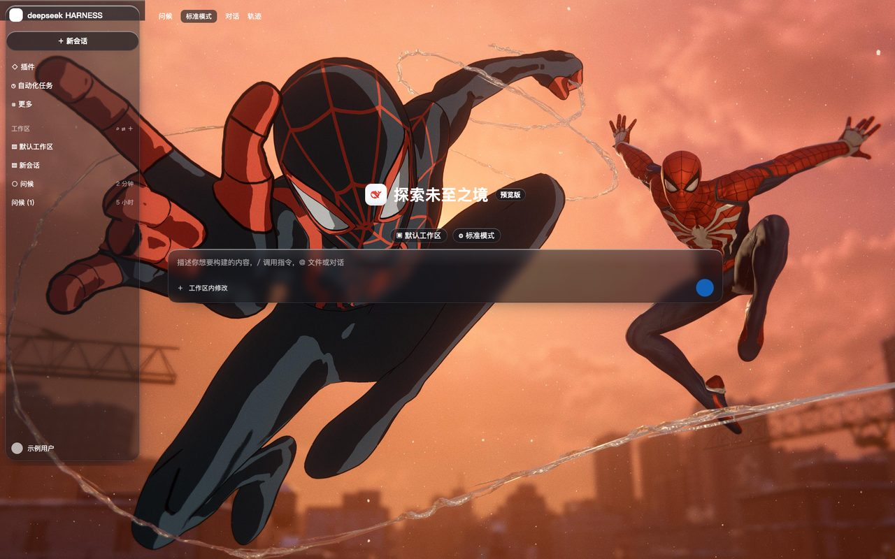
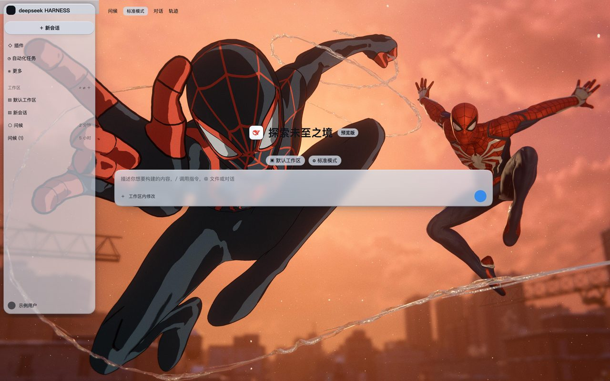

# 透明肥鱼

给 DeepSeek Harness 换上一层**跟着壁纸走**的液态玻璃。壁纸存在你自己的硬盘上，整个插件不联网、不上传、不需要任何服务端。



## 能做什么

- **本地壁纸库**：导入图片或视频，按内容哈希去重；缩略图区分类型并显示时长
- **分区材质**：侧栏、输入框、消息气泡、设置窗口、插件页各用一套厚度与光影，不是一层皮糊满全屏
- **悬浮侧栏**：内缩、圆角、投影，浮在壁纸上而不是贴在窗口边缘
- **气泡区分**：你发的偏绿、助手偏蓝，靠颜色分角色，不用实色块
- **整页型面板**：插件页、自动化任务这类整页，是「一整块薄面 + 各组一块 + 控件各自一道玻璃」的三层结构
- **悬停滑动块**：插件列表里鼠标移动时，是一块玻璃在行之间滑动，不是每行各自变色
- **右侧栏面板**：打开时有材质，最大化时铺满整窗且不透出底下的正文
- **自动深浅**：换壁纸后按画面亮度自动切浅色或深色主题；你手动改过之后，这张壁纸就不再自动
- **可读性兜底**：不透明度拖到很低时会被抬到「文字读得清」的下限
- **不透明度 / 圆角**：两个滑杆实时生效，持久保存



## 安装

需要 DSH ≥ 0.2.0。

```bash
# 从 npm 安装
dsh plugin --profile desktop add dsh-transparent-fish

# 或从本地目录安装（开发用）
dsh plugin --profile desktop add link:/绝对路径/dsh-transparent-fish
```

装完重启 DSH，打开 **设置 → 透明肥鱼**。

## 使用

| 操作 | 位置 |
|---|---|
| 换壁纸 | 设置 → 透明肥鱼 → 壁纸，点缩略图 |
| 加壁纸 | 点「添加壁纸」，或网格末尾的「＋」 |
| 删壁纸 | 悬停缩略图，点右上角 × |
| 调厚薄 | 「不透明度」滑杆，往右更实 |
| 调圆角 | 「圆角」滑杆，三处面板联动 |
| 关掉玻璃效果 | 底部「启用透明肥鱼」开关（立即生效） |

> **两个「启用」不是一回事。**
> 设置里的开关只关掉玻璃效果，插件还在，点一下立刻生效。
> 插件页（插件管理器）里那个开关是**装载开关**：它改的是 profile 的 bundle 清单，DSH 启动时才读一次，所以**要重启 DSH 才生效**。这是 DSH 的机制，不是插件的问题。

视频壁纸：浏览器不允许带声音自动播放，所以默认静音起播，**你第一次点击页面时恢复到你设的音量**。切到后台 / 窗口失焦 / 用电池时的暂停行为可以单独开关。

## 数据存在哪

```
~/.dsh/transparent-fish/
├── wallpapers/<sha256 前 16 位>.<扩展名>
├── library.json      # 壁纸清单
└── settings.json     # 当前选中项
```

**壁纸文件原样保存，不转码、不上传。** 插件的 HTTP 路由只接受回环地址（127.0.0.1），写操作额外校验 Host。删掉这个目录等于清空壁纸库。

## 兼容性

- DSH 0.2.x（`engines.dsh: >=0.2.0-0`，含 0.2.x 的预发布版本）
- 桌面版与 `dsh web` 均可
- 目前主要在 macOS 验证；Windows 下的视频播放与路径处理尚未完整测试

插件依赖 DSH 的页面结构选择器，**DSH 大版本升级后可能出现部分区域未适配**（玻璃仍在，个别面板退回原生样式）。遇到时请在 issue 里附上版本号。

## 卸载

```bash
dsh plugin --profile desktop remove dsh-transparent-fish
rm -rf ~/.dsh/transparent-fish   # 可选：一并删除壁纸库
```

## 开发

```bash
node build.mjs        # src/ → client/client.js（内联 CSS 与 SVG）
```

样式在 `src/glass.css`，客户端逻辑在 `src/client.tpl.js`，构建后合并成 `client/client.js`。

（`preview/` 是开发时用的离线预览页，直接引用真实的 `src/glass.css`，改样式时用它看效果；它不在 npm 包里。）

## License

MIT
